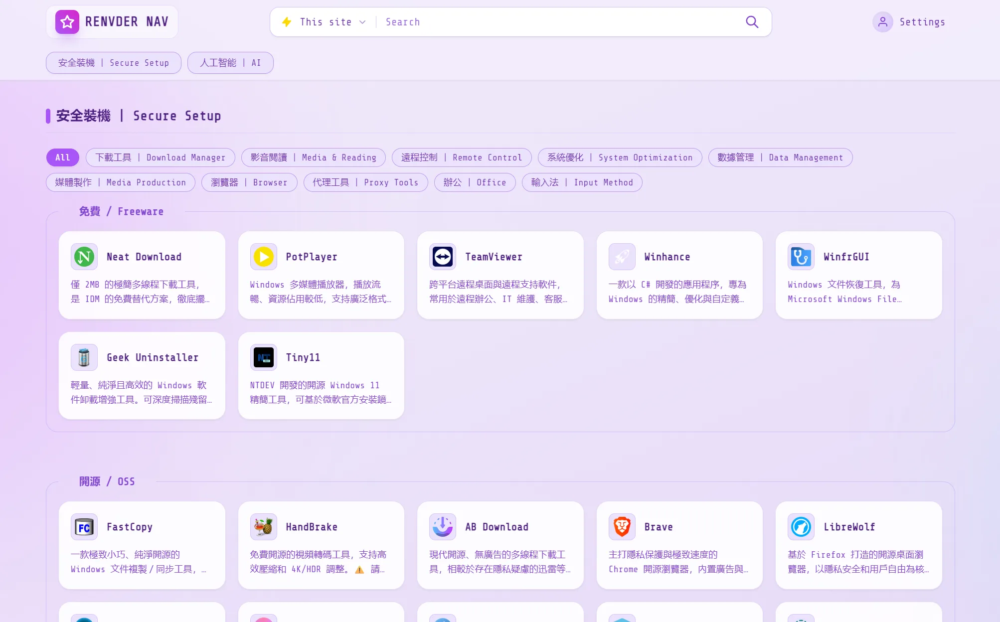
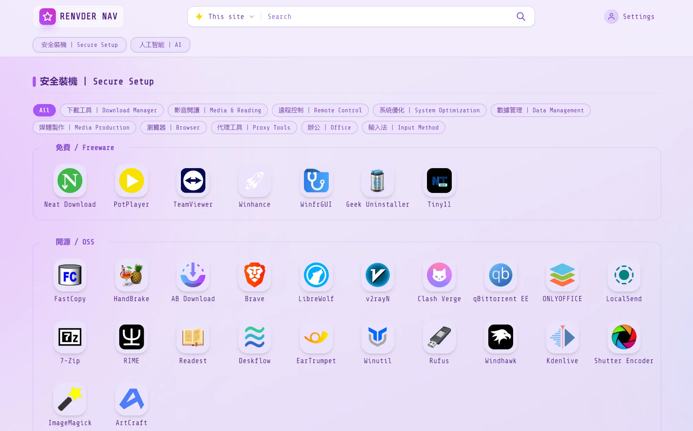
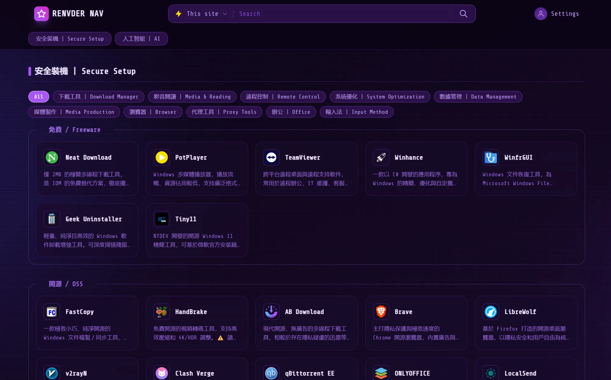
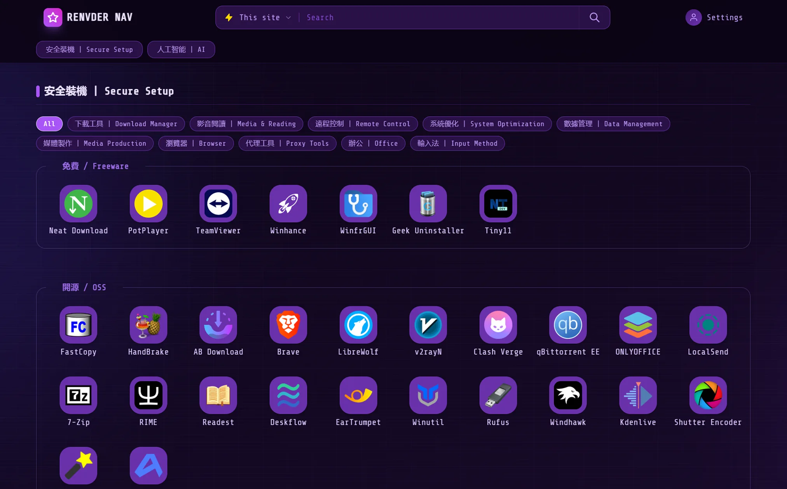

  🌐 <b>EN</b> |
  <a href="./README_tw.md"><b>漢</b></a>

  <h1>cf-workers-nav</h1>
  

    A lightweight startpage hosted on Cloudflare Workers
     
    <i>⚡ Easily build your personalized browser startpage</i>
  

📋 Easy-to-deploy Personal Startpage

> A lightweight browser startpage powered by Cloudflare Workers.
> Features bookmark management, automatic favicon fetching, drag-and-drop reordering, a bilingual interface, and password-protected private links—all in a single Worker file for effortless setup.

## ✨ Features

* **⚡️ Serverless Architecture**: Runs entirely on Cloudflare Workers with zero server setup or maintenance.
* **💾 Cloudflare KV Storage**: Reliable, persistent key-value storage for all your links and settings.
* **🎨 Clean, Modern UI**: Built with Tailwind CSS (precompiled and embedded in the page, so no external CDN is needed), with a responsive layout for desktop and mobile, plus three display styles (Card view, APP view and List view).
* **🚀 Light Startup**: No external scripts run on the page, web fonts load in the background without blocking it, and the "Loading…" indicator appears right away.
* **🌗 Dark Mode That Follows Your System**: Automatically matches your device's light/dark setting on desktop and mobile, and switches live when the system switches (e.g. scheduled day/night mode). You can also toggle it manually from the Settings menu; a manual choice is only remembered across visits if **Remember Settings** is turned on.
* **🖱️ Drag-and-Drop Reordering**: Rearrange categories and bookmark cards via mouse drag on desktop or long-press on mobile.
* **🔒 Password Protection**: Hide sensitive links behind an admin password—visible only when logged in. Failed logins are rate-limited (5 wrong attempts locks that IP for 15 minutes).
* **📂 Flexible Data Management**: Add, edit, or delete links directly on the page. Supports importing HTML bookmarks from Chrome/Edge, plus JSON import/export. Every save automatically keeps a backup of the previous data (at most one per 10 minutes, latest 10 kept). If a second KV namespace is bound as `CARD_ORDER_BACKUP`, every save/import also writes a timestamped copy there, so your links survive even if the main namespace is lost. Import backs up the current data first, and saving or importing an empty dataset over existing data is refused unless explicitly forced; if the KV read fails, the API returns HTTP 500 instead of a silently empty page. Categories also support sub-groups: create an empty group inside a category first, then add links into it, or drag cards between groups. Links can also carry a short filter tag, editable in the Add/Edit dialog; each category shows one row of filter pills under its title, and clicking one shows only the matching links across all its groups. Each named group is shown inside a rounded panel with no fill (only the border outline), with its title sitting on the panel's top border.
* **🩺 One-Click Check** (login required): Check whether each site is reachable and how fast it responds, right from your browser.
* **🖼️ Sharp, Bandwidth-Friendly Icons**: Icons are fetched from high-resolution sources, served unprocessed, and delivered via `srcset` so Retina, 4K and 5K screens get a crisp icon; responses are cached at the edge for a week, so repeat visits load instantly.
* **🔍 Multi-Engine Search**: Search via Google, Bing, or DuckDuckGo, or perform instant quick searches across your saved bookmarks. In-site search unifies Simplified/Traditional Chinese.
* **🌐 Bilingual Interface**: One tap switches the whole page between English and Chinese — labels, tooltips, placeholders, filter pills and buttons all follow. On desktop the switch is the top-bar capsule; on phones it lives in the Settings menu. Each link can store a subtitle and a short intro in both languages, and cards show the one for the current language. Which languages the interface includes (EN and/or Chinese) is a site-wide setting the admin controls with checkboxes in Settings (login required), and every visitor sees that state on any device.
* **🏷️ Custom Logo & Site Name** (login required): choose a logo style from a built-in gallery with colours and shapes, or replace it with a custom image URL (the two are exclusive); the browser tab icon and the top-bar logo update together, and the top-bar site name can be renamed from Settings.
* **🗂️ Card Detail Popup**: A plain click on a card opens a detail popup — icon, title, subtitle, full description, and an **Open Link** button. Ctrl/Cmd+click and middle-click open the link directly, as before.
* **🎨 Card Colors**: Every link can be assigned a color from a soft palette; in dark mode the card background is tinted with it, the border tint appears only on hover, and the subtitle carries the color's tone; in light mode the card stays pure white and the color shows only as the hover border, with the subtitle in the same hue's muted grey.
* **🖥️ Big-Screen Friendly**: On wide and ultrawide monitors the page automatically scales to fill the screen, and the card grid extends to six columns on the widest setups. Phones keep the mobile layout.

## Interface Preview

### Light Mode
| Card View | APP View |
|-|-|
| | |

### Dark Mode
| Card View | APP View |
|-|-|
| | |

## Deployment

### Deploying to Cloudflare

Click to expand setup guide

#### Setup Steps

1. **Log in to [Cloudflare](https://www.cloudflare.com)** and create a new Worker:
   - Copy the code from `workers.js` in this repository, paste it into the Worker editor, and click **Save and Deploy**.

2. **Create a KV Namespace**:
   - Go to **Workers & Pages > KV** in the Cloudflare dashboard and create a namespace named `CARD_ORDER`. Optionally, create a second namespace named `CARD_ORDER_BACKUP` for offsite backups (see step 3).

3. **Bind the KV Namespace**:
   - Open your Worker's **Settings > Bindings** (in older dashboards: **Settings > Variables > KV Namespace Bindings**), add a KV binding with the variable name `CARD_ORDER`, and link it to the `CARD_ORDER` namespace created above. If you created the backup namespace, add a second binding with the variable name `CARD_ORDER_BACKUP` linked to `CARD_ORDER_BACKUP`; the Worker writes a backup copy there on every save/import, and works fine without it.

4. **Configure Environment Variables**:
   - Go to your Worker's **Settings > Variables and Secrets** and add the variables listed in the table below.
   - Add `ADMIN_PASSWORD` and `JWT_SECRET` with the type **Secret** so their values are encrypted and hidden after saving. Other variables can use the type **Text**.
   - Click **Deploy** afterwards so the changes take effect.

5. **Add a Custom Domain** (Optional):
   - Under **Settings > Domains & Routes**, assign a custom domain or use the provided `*.workers.dev` subdomain.

 

#### Environment Variables

> Variables marked with "Required" must be configured. Unset optional variables will fall back to their default values.

| Variable | Required | Description | Default |
|---|---|---|---|
| `ADMIN_PASSWORD` | ✅ Required | Admin login password (minimum **8 characters**; a long, unique password is recommended) | None |
| `JWT_SECRET` | ✅ Required | Secret key for signing login tokens. Must be a random string of **≥ 32 characters** (a password manager's generator works well) | None |
| `DEFAULT_USER` | ⬜ Optional | Data identifier. Your links are stored in KV under this name, so changing it later makes the page show a different (empty) dataset; the old data stays in KV under the old name | `testUser` |
| `ALLOWED_ORIGINS` | ⬜ Optional | Origins allowed to call the API from another domain (CORS), comma-separated. Only needed if you call the API from a different site | Empty (same-origin only) |
| `ICON_API` | ⬜ Optional | Third-party favicon API. The site URL is URL-encoded and appended to the end of this value, so it must end with the query parameter, e.g. `https://api.xinac.net/icon/?url=` | Built-in (xinac) |
| `PREFER_ICON_API` | ⬜ Optional | `true`: ask the favicon API first, then fall back to fetching from the site itself. `false`: never contact the third-party API and fetch icons directly from each site (**more private**, see below). Use exactly `true` or `false` in lowercase; any other value is treated as `false` | `true` |

#### 🔐 Privacy Tip: `PREFER_ICON_API`

With the default (`true`), the Worker sends **every link's URL to the favicon API** (xinac by default) to get its icon. This includes private links whenever they are displayed after login.

If you would rather not share your links with a third party, add `PREFER_ICON_API` = `false` under **Settings > Variables and Secrets** and click **Deploy**. Icons are then fetched straight from each website (`/favicon.ico`, then the icons declared in the page). The trade-off: a few sites may not provide a fetchable icon and will show the default icon instead.

> Icons that were already fetched stay cached for up to 7 days, so the change fully applies once old icons expire.

#### Upgrading from Older Versions

> - If your previous setup lacked `JWT_SECRET` or used a string shorter than 32 characters, you **must** update it to a random string of **≥ 32 characters**. Otherwise the Worker refuses to run and returns `Server is not configured` (HTTP 500) with the message `JWT_SECRET is not configured or not strong enough (needs ≥ 32 characters)`.
> - If your existing `ADMIN_PASSWORD` is shorter than 8 characters, update it to at least **8 characters**, otherwise the same error is returned.
> - Always click **Deploy** after modifying variables for changes to take effect.
> - Earlier versions saved the automatically detected theme in the browser, which stopped the page from following later system changes. The current version ignores that old value, so no manual clean-up is needed.

## 🛡️ Privacy & Security Notes

* **Favicon service**: see the `PREFER_ICON_API` tip above.
* **Third-party resources in the browser**: no third-party scripts run on the page (Tailwind CSS is embedded), so the login token cannot be exposed through a compromised CDN. The only external resource is Google Fonts (loaded in the background; if it is unreachable, system fonts are used). The admin login token is kept in the browser's `localStorage`, so on a shared or public computer, always use **Login / Logout** to sign out after editing. On your own personal device, staying logged in is fine.
* **Logout signs out every device**: logging out revokes all existing sessions (phone and computer alike). A logout request only takes effect when it carries a valid login token, so outsiders cannot force you to be signed out.
* **Private links** are filtered on the server: visitors who are not logged in never receive them.
* **Login protection**: 5 wrong passwords lock the visiting IP for 15 minutes. Login tokens last 2 hours and are renewed automatically through an HttpOnly cookie (up to 30 days).

For developers: updating the embedded styles

The page's Tailwind CSS is precompiled and stored in the `<style id="tw-compiled">` block inside the HTML. If you add or change Tailwind utility classes in the page, that block must be regenerated, otherwise the new classes will have no styling.

1. Save the page's HTML to a file named `page.html`.
2. Use the `tailwind.config.js` from this repository (Tailwind CSS v3.4, `darkMode: 'class'`, with the theme's colors, fonts and shadows) and an `input.css` containing `@tailwind base; @tailwind components; @tailwind utilities;`.
3. Run `npx tailwindcss@3.4.17 -c tailwind.config.js -i input.css -o out.css --minify`.
4. Replace the contents of `<style id="tw-compiled">` with `out.css`. Because the HTML lives inside a JavaScript template literal in the Worker, every backslash in the CSS must be doubled (`\` → `\\`).

## 📝 Changelog

**2026-11-18**
* List view on phones: text in list rows is enlarged (title 15px, subtitle 12px, description 13px) to reach mobile-readable sizes; grid-view cards keep their compact text.

**2026-11-17**
* Session reliability: a network blip (offline, WiFi switch, temporary server failure) is no longer treated as "session expired" and logged out; logout now happens only when the server explicitly rejects the session.
* Icon reliability and freshness: SVG icons that failed to show now display; icons and the page update immediately after a redeploy (icon URLs carry a version stamp, the page cache key carries a content hash); one icon keeps one cached copy, not three.
* List view on phones: cards stay inside the panel border, and the description shares the same left edge line as the title.
* Server notes: edge caching works only on a custom domain (the Cache API is inactive on *.workers.dev); on the Free plan, processing a very large source icon may exceed the 10ms CPU limit.
* List view: a third display style in Settings — compact rows with a bare icon, title and full description; clicking a row opens the link directly, management buttons show only in card view.
* Icon tiles: the tile background is derived from the icon glyph's own dominant colour (pixels are inspected, never modified) — dark glyphs get a light tint, white silhouettes get a dark tile, so every icon stays visible.
* App view: on wide screens the App grid extends to more columns for a denser icon wall.
* Login button: shows Login when logged out and Logout when logged in (登入／登出 in Chinese); switching language restores the label cleanly in both directions.
* Icons: all server-side image processing (centering, resizing, background peeling) is removed and fetched images are served as-is, so the deployed page looks exactly like the local preview, without jagged edges. Icon sources are tried high-resolution first, solid-background icons are skipped, and tiny favicons are only a last resort, so card icons show clearly.
* App view icons: the inner padding of the App icon tiles is reduced so the fetched logo displays larger inside the tile. Tile size, rows per line, spacing, rounded corners and border are unchanged; list-view cards and the popup keep the old behaviour.
* Dark-mode custom icons: the Add/Edit dialog gains a second icon field, "Icon URL (Dark Mode)". Fill both fields and dark mode shows the second URL while normal mode shows the first; fill only one field and the same icon serves both modes as before. The detail popup follows the current mode, and flipping the theme switch swaps card icons on the spot.
* Icon tiles: inner padding is widened so full-bleed icons are no longer clipped by the tile's rounded corners, and the hover zoom is kept.
* Popup: the detail popup reuses the icon the card already loaded, so opening a popup causes no extra fetch.
* Language checkboxes are a site-wide setting: the admin's choice is stored on the server, so every visitor on any device sees the same language mode; local storage is only a first-paint cache.
* Light mode: the palette adopts the colour values of a published lavender scheme — flat light-lavender page #E7E6F3, pure white cards, three text layers (title #343A50, description #5D617F, subtitles in muted tones of the card colours), flat purple #6A63B3 for selection, hover and focus, pink #F583C0 for the language capsule, filter-pill hover and the colour-picker row, a slightly deeper top bar #DCDCEC, light-lavender icon tiles #E5E4F1; in light mode the ten card colours show as flat muted fills with the same hue's muted grey subtitles, so light mode is no longer vivid. Dark mode is unchanged.
* Filter pills: hovering an unselected pill paints a contact background — pink #F583C0 in light mode; in dark mode the same scheme's dark accent applies: deep lavender #2E2840 with pink text #FF96C9.
* Language capsule: pixel measurement showed the EN and Han glyphs sat ~0.75px above their segment centres; segment padding is now asymmetric (larger top, smaller bottom) so the text sits dead centre in the top-bar and settings capsules, in both modes.

**2026-11-16**
* App view: App cards show the icon only, centered, for a cleaner grid.
* Icon display: icons are centered server-side with a guaranteed transparent margin on all sides, so full-bleed circular icons no longer look clipped by the card corners; icon sources are tried in a fixed priority order, starting with the site's own icon link.
* Language switching is split by device: desktop switches with the top-bar capsule only; phones use the language checkboxes in the Settings menu, which appear only when logged in.
* Small screens: card text shrinks on narrow screens so titles fit.
* Logo customisation (login required): pick a style from a built-in gallery, choose a colour, switch between rounded square and circle, or use a custom image URL instead (gallery and URL are exclusive); the tab icon and the top-bar logo update together.
* Site name: the top-bar site name can be renamed in the same dialog; leaving it empty restores the default. The browser tab title is unchanged.
* Login-gated settings: the second-language label, data tools and Logo settings all appear only when logged in.
* Mobile typing: the mobile search bar uses 16px text, so iOS Safari no longer zooms the page while typing.
* Popup button: the Open Link button in the detail popup is tinted with the card's colour.
* Card layout: the subtitle now sits directly under the title beside the icon, tinted with the card's colour, while the short intro stays gray below — the same three-level hierarchy as the detail popup.

**2026-11-15**
* iPad/iOS background stability: fixed the dark-mode grid texture jumping during scroll (fixed blend-mode overlay became a normal body background, big blur blobs became radial gradients).
* Unified Simplified/Traditional search: queries and stored data are normalized before matching, so Simplified and Traditional Chinese searches cross-match. The page embeds the OpenCC `TSCharacters` table (Apache-2.0).
* Bilingual interface: a top-bar capsule switches the whole page between English and the second language — labels, tooltips, placeholders, filter pills and buttons all follow. Each link can store a subtitle and a short intro in both languages, and cards show the current language's one. The language choice is remembered, persisted across visits when **Remember Settings** is on.
* Card layout: cards now show the main title, the subtitle in the current language, and a short intro in the space below.
* Detail popup: clicking a card opens a detail popup (icon, title, subtitle, full description, Open Link). Ctrl/Cmd+click and middle-click open the link directly, as before.
* Card colors: each link can be assigned a color from a soft palette; the background is tinted with it, and the border tint appears only on hover.
* Big screens: the page auto-scales on wide and ultrawide monitors so it fills the screen, and the card grid extends to six columns on ultrawide.
* Top bar: language switching no longer shifts the top bar elements; switching keeps the view anchored at the active category; on phones the top bar is compacted so the settings button is no longer clipped.
* Search: typing in the search bar no longer draws a large purple focus frame; the bar shows a soft glow instead.
* Edit dialog: its height is capped to the screen, the form scrolls, and the header and Confirm/Cancel stay visible. Tooltips follow the cursor.

**2026-11-13**
* Sub-groups: a category can now hold named sub-groups. Create an empty group first via the "+ New Group" button, then add links into it (or drag cards across groups); groups can be renamed or deleted (deleting a group ungroups its links, never deletes them). Empty groups survive save and reload.
* Filter tags: each link can carry a short filter tag, editable in the Add/Edit Link dialog (with suggestions from the category's existing tags). Each category shows one row of filter pills under its title — clicking one shows only the matching links across all its groups, and groups with no match hide their header until the filter is cleared.
* Tab highlight: clicking a category tab now highlights it immediately, and the scroll spy follows the actual scroll position (previously the highlight could stay stuck on the first tab when the page was short).
* Group headers: more space between groups, and group titles are smaller and muted so they read as subordinate to the category title.
* Tag length: the filter-tag limit is now 30 characters (was 20), so tags are no longer cut off on save.
* Group panels: each named group is now shown inside a rounded panel (light mode: translucent white fill with a soft violet border; dark mode: a violet tint with a stronger violet border). The panel hides together with its group when a filter leaves it empty; ungrouped links and search results have no panel.
* Panel titles: the group title now sits on the panel's top border, and the border breaks evenly around it. In APP view the panel's top padding is slightly larger, so the icon tiles and the link names sit the same distance from the panel's top and bottom edges.
* Panel background removed: the group panels now have no fill in either mode — only the border outline shows, with the page background showing through.
* One-tag filters: a category with only one filter tag now shows its pills row (previously the row only appeared with two or more tags, so a single tag had no visible UI).
* Panel spacing: the gap between group panels inside a category is now 32px (was 56px) — tighter, matching the gap between the filter pills and the first panel.
* Offsite backup throttle: the backup copy in the second KV namespace is now written at most once every 10 minutes (was on every save), so each save costs about 2 KV writes instead of 3 — the free plan now allows about 500 saves per day. If a namespace vanished, at most 10 minutes of edits would be lost.

**2026-11-12**
* Reliability: if the KV namespace is deleted or unreadable, `/api/getLinks` now returns HTTP 500 instead of a silently empty page; saving or importing an empty dataset over existing links is refused (HTTP 409) unless explicitly forced, and import backs up the current data first.
* Offsite backup: binding a second KV namespace as `CARD_ORDER_BACKUP` keeps a timestamped copy of your data on every save/import (latest 10 kept), so links survive losing the main namespace.
* Fixes: cookie parsing, UTF-8-safe base64 helpers, link matching by URL + name, icon cache cap, and security headers on HTML responses.

**2026-09-23**
* Icons: `/api/icon` now accepts a `w` size parameter and resizes/re-encodes icons at the edge via Cloudflare Image Resizing (AVIF/WebP when the browser supports it), each size and format cached separately. The page requests icons through `srcset` at 1x/2x/3x so Retina/4K/5K screens get a sharp icon without oversized downloads on ordinary screens. Custom icon URLs saved on a link are now also routed through the proxy (previously they bypassed it entirely, loading the original file at full size with no caching).

**2026-09-20**
* Performance: Tailwind CSS is now precompiled and embedded in the page instead of being loaded from `cdn.tailwindcss.com`; Google Fonts no longer blocks the page from starting; the login check no longer runs twice at startup; the "Loading…" indicator shows from the first paint; idle dialog overlays are fully hidden (`display: none`) instead of sitting invisibly on top of the page.

**2026-09-19**
* Dark mode: the page now truly follows the system theme, including live switching. A manual choice is saved only when **Remember Settings** is on, and enabling that option now saves the theme actually in use. Added `color-scheme` / `theme-color` so native controls and the mobile browser bar match the theme.
* Security: `/api/logout` now requires a valid login token.
* Docs: added the privacy tip for `PREFER_ICON_API`; corrected the search engine list (DuckDuckGo instead of Baidu); corrected the `ALLOWED_ORIGINS` default (same-origin only, not unrestricted); clarified `JWT_SECRET`, `ICON_API` and `DEFAULT_USER`.

## 🙏 Acknowledgments

This project is a fork of [lineagett/cf-workers-nav](https://github.com/lineagett/cf-workers-nav), with additional reliability and backup hardening.

Special thanks to **[Cloudflare](https://www.cloudflare.com/)**, **[Tailwind CSS](https://tailwindcss.com/)**, **[hmhm2022](https://github.com/hmhm2022)**, **[xinac](https://api.xinac.net/)**, and **[OpenCC](https://github.com/BYVoid/OpenCC)** (source of the Apache-2.0 Simplified/Traditional character table used by unified search).
