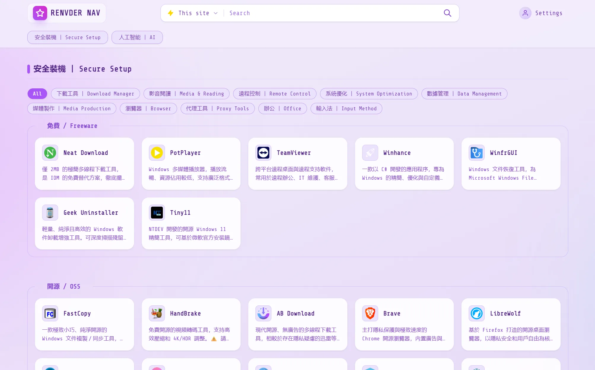
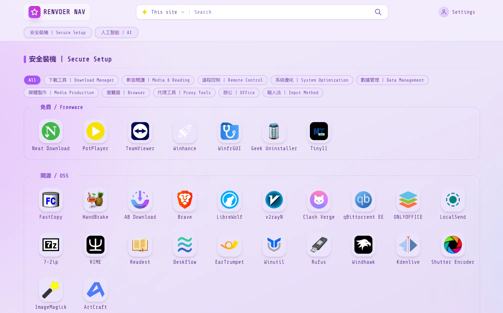
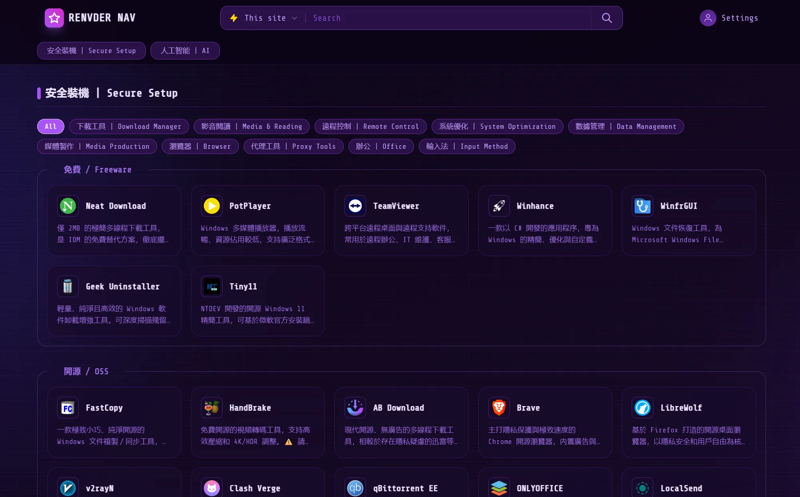
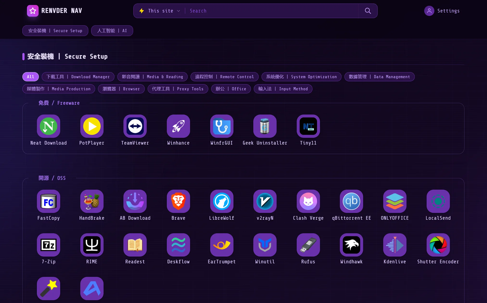

  🌐 <a href="./README.md"><b>EN</b></a> |
  <b>漢</b>

  <h1>cf-workers-nav 個人導航頁</h1>
  

    部署於 Cloudflare 上的輕量化導航頁
     
    <i>⚡ 輕鬆打造屬於自己的瀏覽器起始頁</i>
  

📋 輕鬆部署的個人導航頁 

> 一款部署於 Cloudflare 上的輕量化導航頁面。
> 整合書籤管理、圖標自動抓取、拖拽排序、雙語界面、私密鏈接保護等功能，Worker 單一文件設計，方便快速部署。

## ✨ 主要特色

*   **⚡️ Serverless 架構**：完全執行於 Cloudflare Workers 上，無需維護服務器。
*   **💾 KV 存儲空間**：數據安全存儲於 Cloudflare KV 中。
*   **🎨 簡潔 UI**：基於 Tailwind CSS（已預先編譯並內嵌於頁面，不依賴外部 CDN），響應式設計完美相容電腦與移動設備，並提供卡片視圖、APP 視圖與列表視圖三種顯示風格。
*   **🚀 輕量啟動**：頁面不執行任何外部腳本，網頁字體改為背景載入、不會擋住頁面，「Loading…」提示會在第一時間顯示。
*   **🌗 自動跟隨系統的深色模式**：電腦與手機都會自動採用設備目前的淺色/深色設置，系統切換時（例如定時日夜模式）頁面也會即時跟著切換。也可在「設置」菜單手動切換；手動選擇只有在開啟 **Remember Settings（記住設置）** 時才會跨次記住。
*   **🖱️ 拖拽排序**：支持電腦端鼠標拖拽與移動設備長按拖拽，輕鬆整理分類與卡片順序。
*   **🔒 私密保護**：支持設置「私密鏈接」，僅在管理員登錄後可見。登錄失敗有次數限制（錯誤 5 次，該 IP 鎖定 15 分鐘）。
*   **📂 數據管理**：支持在線新增/編輯/刪除鏈接，可導入 Chrome / Edge 的 HTML 書籤，並支持 JSON 格式數據導入/導出。每次保存都會自動備份舊數據（每 10 分鐘最多一份，保留最新 10 份）。若另外綁定第二個 KV 命名空間（變數名 `CARD_ORDER_BACKUP`），每次保存/導入還會在那裡寫一份帶時間戳的備份，即使主命名空間丟失，鏈接也不會跟著沒了。導入前會先備份現有數據；用空數據覆蓋已有鏈接會被拒絕（除非明確強制）；KV 讀取失敗時 API 會返回 HTTP 500，而不是悄悄顯示空白頁。分類裡還支持二級分組：先建一個空分組，再往裡面加鏈接，也可以拖拽卡片換分組。鏈接還可以帶一個篩選標籤，在新增/編輯對話框裡修改；每個分類的標題下方會顯示一行篩選膠囊，點一下只顯示該分類裡符合標籤的鏈接。每個命名的分組會顯示在一個沒有底色的圓角面板裡（只剩邊線），標題壓在面板的上邊線上。
*   **🩺 一鍵檢測**（需登錄）：直接從瀏覽器檢查每個網站是否可連接及響應速度。
*   **🖼️ 清晰又省流量的圖標**：圖標按高清順序抓取、原樣輸出不做加工，透過 `srcset` 提供，讓 Retina、4K、5K 屏幕拿到清晰圖標；回應在邊緣節點快存一週，重複訪問秒載。
*   **🔍 整合搜索**：內建多款搜索引擎（Google、Bing、DuckDuckGo）及站內快捷搜索。站內搜索支持簡繁互通。
*   **🌐 雙語界面**：整頁切換中英文——標籤、提示氣泡、占位符、篩選膠囊、按鈕都會跟著換。桌面端的切換入口是頂欄膠囊，手機端在設置菜單裡，每個裝置只有一個入口。每個鏈接可分別填寫兩種語言的副標題和簡短介紹，卡片上只顯示目前語言的那一份。介面包含哪些語言（EN 與/或 漢）是全站設置，由管理員在設置中以複選框控制（需登錄），任何人任何設備打開都看到同一狀態。語言選擇會被記住，開啟 **Remember Settings（記住設置）** 時跨次保存。
*   **🏷️ 自訂 LOGO 與站名**（需登錄）：從內建圖庫選樣式、配色、圓角方形或圓形，或改用圖片網址（二者二選一）；瀏覽器分頁圖標與頂欄 LOGO 一起更新，頂欄站名也能在設置中改名。
*   **🗂️ 卡片詳情彈窗**：點擊卡片會打開詳情彈窗——圖標、標題、副標題、完整介紹，以及「打開鏈接」按鈕。Ctrl/Cmd+點擊與中間鍵點擊維持直接打開鏈接。
*   **🎨 卡片顏色**：每個鏈接可指定一個柔和色系；深色模式下卡片背景淡淡染上該色，邊框染色只在鼠標懸停時出現，副標題染同一顏色；淺色模式下卡片保持純白，顏色只作為懸停描邊出現，副標題為同色相的高級灰。
*   **🖥️ 大屏自適應**：寬屏與超寬螢幕會自動縮放鋪滿畫面，最寬螢幕下卡片網格增至六欄；手機維持手機佈局。

## 界面預覽

### 淺色模式
| 卡片視圖 | 圖標視圖 |
|-|-|
| | |

### 深色模式
| 卡片視圖 | 圖標視圖 |
|-|-|
| | |

## 部署方式

### 部署至 Cloudflare

點擊展開部署步驟

#### 部署步驟

1. **登錄 [Cloudflare](https://www.cloudflare.com)** 並創建 Worker：
   - 複製倉庫中 `workers.js` 的代碼，貼入 Worker 編輯器中，點擊部署。

2. **創建 KV 存儲空間**：
   - 在 Cloudflare 控制台的 **Workers & Pages > KV** 中創建名為 `CARD_ORDER` 的 KV 命名空間，用於保存數據。建議再建第二個名為 `CARD_ORDER_BACKUP` 的命名空間，用作站外備份（見第 3 步）。

3. **綁定 KV 命名空間**：
   - 在 Worker 的 **設置 > 綁定**（舊版控制台為 **設置 > 變數 > KV 命名空間綁定**）新增 KV 綁定，變數名稱填寫 `CARD_ORDER`，並綁定至上一步創建的 `CARD_ORDER` 命名空間。若建了備份命名空間，再新增一條綁定，變數名稱填寫 `CARD_ORDER_BACKUP`，綁定至 `CARD_ORDER_BACKUP`；每次保存/導入 Worker 都會在那裡寫一份備份，不綁也能正常使用。

4. **設置環境變數 / 參數**：
   - 到 Worker 的 **設置 > 變數和機密**，依下方表格新增各項變數。
   - `ADMIN_PASSWORD` 與 `JWT_SECRET` 請選擇類型 **機密（Secret）**，保存後內容會加密並隱藏；其他變數使用類型 **文字（Text）** 即可。
   - 設置完成後務必點擊 **部署**，變更才會生效。

5. **新增自訂域名**（選填）：
   - 若需使用自訂域名，可在 Worker 的 **設置 > 域名與路由** 中新增自訂域名，或直接使用 `*.workers.dev` 子域名。

 

#### 環境變數說明

> 表中標註了「必填」與「選填」；未設置選填項目時將使用默認值。

| 變數名稱 | 必填 | 說明 | 默認值 |
|---|---|---|---|
| `ADMIN_PASSWORD` | ✅ 必填 | 管理員登錄密碼，長度至少 **8 個字符**（建議使用長且獨一無二的密碼） | 無 |
| `JWT_SECRET` | ✅ 必填 | 用於簽署登錄 Token 的密鑰，必須是 **≥32 個字符** 的隨機字符串（可用密碼管理器產生） | 無 |
| `DEFAULT_USER` | ⬜ 選填 | 數據識別名稱。你的鏈接會以此名稱存放在 KV 中，之後若更改，頁面會改讀另一份（空白的）數據，舊數據仍留在 KV 的舊名稱下 | `testUser` |
| `ALLOWED_ORIGINS` | ⬜ 選填 | 允許從其他域名呼叫 API (CORS) 的來源，多個來源請用半形逗號分隔。只有需要從其他網站呼叫 API 時才需設置 | 空白（僅限同源） |
| `ICON_API` | ⬜ 選填 | 第三方圖標 API。網站網址會經 URL 編碼後直接接在此值後面，因此值必須以查詢參數結尾，例如 `https://api.xinac.net/icon/?url=` | 已內建 xinac |
| `PREFER_ICON_API` | ⬜ 選填 | `true`：優先向圖標 API 取得圖標，失敗再改由網站本身取得。`false`：完全不連接第三方 API，直接從各網站取得圖標（**較保護隱私**，見下方說明）。請填小寫的 `true` 或 `false`，其他值一律視為 `false` | `true` |

#### 🔐 隱私建議：`PREFER_ICON_API`

默認（`true`）時，Worker 會把**每個鏈接的網址傳給圖標 API**（默認為 xinac）以取得圖標，登錄後顯示的私密鏈接也包含在內。

若不想把鏈接交給第三方，請在 **設置 > 變數和機密** 新增 `PREFER_ICON_API` = `false` 並點擊 **部署**。之後圖標會直接從各網站取得（先試 `/favicon.ico`，再讀取網頁中宣告的圖標）。代價是：少數網站無法取得圖標時，會顯示默認圖標。

> 已取得的圖標最多會快取 7 天，因此需等舊圖標過期後，變更才會完全生效。

#### 舊版本升級提醒

> - 舊版本若**未設置 `JWT_SECRET`**，或設置的 `JWT_SECRET` **少於 32 個字符**，必須重新設置一個 **≥32 個字符** 的隨機字符串，否則 Worker 會拒絕執行，並返回 `Server is not configured`（HTTP 500），消息為 `JWT_SECRET is not configured or not strong enough (needs ≥ 32 characters)`。
> - 舊版本若 **`ADMIN_PASSWORD` 少於 8 個字符**，請一併更新為**至少 8 個字符**的新密碼，否則同樣會出現上述錯誤。
> - 修改變數後需點擊 **部署**，設置才會生效。
> - 舊版本會把自動檢測到的主題存進瀏覽器，導致頁面之後不再跟隨系統變化。新版會忽略這個舊值，不需要手動清除。

## 🛡️ 隱私與安全說明

* **圖標服務**：請見上方 `PREFER_ICON_API` 隱私建議。
* **瀏覽器載入的第三方資源**：頁面不執行任何第三方腳本（Tailwind CSS 已內嵌），因此登錄 Token 不會因為 CDN 被入侵而洩露。唯一的外部資源是 Google Fonts（在背景載入，無法連接時會改用系統字體）。管理員登錄 Token 存放在瀏覽器的 `localStorage`，因此在共享或公用電腦上編輯後，務必使用 **Login / Logout** 登出；在自己的個人設備上則可保持登錄。
* **登出會讓所有設備一起登出**：登出會撤銷所有現有登錄狀態（手機、電腦都會掉線）。登出請求必須帶有效的登錄 Token 才會生效，外人無法強制讓你被登出。
* **私密鏈接**由服務器端過濾：未登錄的訪客根本不會收到這些數據。
* **登錄保護**：密碼錯誤 5 次會鎖定該來源 IP 15 分鐘。登錄 Token 有效期 2 小時，並透過 HttpOnly Cookie 自動續期（最長 30 天）。

開發者說明：更新內嵌樣式

頁面的 Tailwind CSS 已預先編譯，存放在 HTML 內的 `<style id="tw-compiled">` 區塊。如果你在頁面中新增或修改了 Tailwind 樣式類別，必須重新產生這個區塊，否則新的類別不會有任何樣式。

1. 將頁面的 HTML 存成名為 `page.html` 的文件。
2. 使用倉庫中的 `tailwind.config.js`（Tailwind CSS v3.4、`darkMode: 'class'`，內含主題的顏色、字體與陰影設置），以及內容為 `@tailwind base; @tailwind components; @tailwind utilities;` 的 `input.css`。
3. 執行 `npx tailwindcss@3.4.17 -c tailwind.config.js -i input.css -o out.css --minify`。
4. 用 `out.css` 的內容取代 `<style id="tw-compiled">` 裡的內容。因為 HTML 位於 Worker 的 JavaScript 模板字符串中，CSS 裡的每個反斜線都必須加倍（`\` → `\\`）。

## 📝 更新紀錄

**2026-11-18**
* 手機列表視圖：列表行文字放大（標題 15px、副標 12px、說明 13px）達到移動閱讀標準；網格卡片維持緊湊字號。

**2026-11-17**
* 會話可靠度：網絡抖動（離線、WiFi 切換、服務器一時故障）不再被當成「會話過期」踢出登入；只有服務器明確拒绝才登出。
* 圖標可靠性與新舊：過去失效不顯示的 SVG 圖標現可正常顯示；重新部署後圖標與頁面即時更新（圖標 URL 帶版本號、頁面快存帶內容哈希）；同一圖標只存一份快存、不再存三份。
* 手機列表視圖：卡片貼合板塊邊線，詳情文字與標題共用同一條左邊線。
* 服務器現狀：邊緣快存只在自定義域名下生效（*.workers.dev 上 Cache API 不工作）；免費套餐 CPU 上限 10ms，超大來源圖標的處理可能超限。
* 列表視圖：設置新增第三種顯示樣式——緊湊行式卡片：裸圖標、標題、完整說明；點行直接打開鏈接，管理按鈕只在卡片視圖顯示。
* 圖標板配色：板底由圖標自身主色推導（像素只讀不改）——深色圖形配淺色底、白色輪廓配深色底，任何圖標都清晰可見。
* App 視圖：寬螢幕下 App 網格擴展更多欄，圖標牆更密。
* 登錄按鈕：未登錄顯示 Login、登錄後顯示 Logout（漢模式登入／登出）；切換語言兩邊都乾淨還原。
* 圖標：移除伺服器端的全部圖像加工（居中、縮放、剝底），抓到的圖原樣輸出，部署後的頁面與本地預覽完全一致、沒有毛刺；圖標來源按高清順序查找，實底圖標自動跳過，小圖只做兜底，卡片圖標顯示清晰。
* 圖標板：板內留白加大，貼滿的圖標不再被圓角切角，懸停縮放動畫保留。
* App 視圖圖標：App 圖標板的內留白縮小，抓到的 logo 在板內顯示得更大；板大小、每行個數、間距、圓角、邊框完全不動，列表卡片與彈窗維持舊行為。
* 深色模式自定義圖標：編輯框新增第二條圖標欄「圖標網址 (深色模式)」。兩欄都填：非深色顯示第一欄、深色顯示第二欄；只填一欄：兩模式同一圖，與舊行爲完全相同。彈窗跟隨當前模式，切換主題開關圖標即時換源。
* 彈窗：詳情彈窗複用卡片已載入的圖標，打開彈窗不再產生額外抓取。
* 語言複選框成為全站設置：管理員的勾選存於伺服器，任何人任何設備打開都看到同一語言模式；本地存儲降為首幀快存。
* 淺色模式：配色取用公開薰衣草紫方案的色值——淺薰衣草灰平鋪底 #E7E6F3、卡片純白、文字三層（標題 #343A50、描述 #5D617F、副標題為卡板色的高級灰）、選中／懸停／焦點環為平紫 #6A63B3、語言膠囊與分類膠囊懸停與色盤列底為粉紅 #F583C0、頂欄略深一档 #DCDCEC、圖標板淺薰衣草 #E5E4F1；十色卡片在淺色下平鋪高級灰底色、副標題為同色相的高級灰，淺色不再鮮豔。深色模式零改動。
* 分類膠囊：鼠標懸停未選中膠囊出現接觸色背景——淺色模式粉底深字；深色模式按同方案的深色 accent，深薰衣草底 #2E2840＋粉字 #FF96C9。
* 語言膠囊：像素量測發現 EN 與漢在段內偏高約 0.75px，把段的上內邊距加大、下內邊距縮小，使文字上下正中；頂欄與設置膠囊、深淺模式一體適用。

**2026-11-16**
* App 視圖：App 卡片只顯示圖標並置中，版面更乾淨。
* 圖標顯示：圖標在伺服器端自動置中，並保留四邊透明邊距，貼滿的圓形圖標不再被卡片圓角裁切；圖標來源依固定優先順序查找，網站自己的圖標連結優先。
* 語言切換按裝置分工：桌面端只用頂欄膠囊；手機端用設置菜單裡的語言勾選框，只在登錄後顯示。
* 小螢幕：卡片文字在窄螢幕自動縮小，標題更貼合。
* LOGO 自訂（需登錄）：從內建圖庫選樣式、挑配色、切換圓角方形與圓形，或改用圖片網址（圖庫與網址二選一）；分頁小圖標與頂欄 LOGO 一起更新。
* 站名：頂欄站名可在同一個設置對話框中改名，清空即恢復默認；瀏覽器分頁標題不變。
* 設置權限：第二語言標籤、導入導出與 LOGO 設置都在登錄後才顯示。
* 手機打字：手機端搜索條改用 16px 字體，iOS Safari 輸入時不再自動放大頁面。
* 彈窗按鈕：詳情彈窗的「打開鏈接」按鈕會染上該卡片的顏色。
* 卡片佈局：副標題移到標題正下方（與標題同屬圖標右欄），並染上卡片配色；簡短介紹保持灰色在下方——三層資訊層次與彈窗一致。

**2026-11-15**
* iPad/iOS 背景穩定性：修復深色模式網格紋理在滾動時跳動的問題（fixed 混合層改為一般 body 背景，大面積模糊光斑改徑向漸層）。
* 簡繁統一搜索：搜索時查詢與資料先歸一再比對，簡體與繁體可互相搜到。頁面內嵌 OpenCC `TSCharacters` 字表（Apache-2.0）。
* 雙語界面：頂欄膠囊可整頁切換中英文——標籤、提示氣泡、占位符、篩選膠囊、按鈕都會跟著換。每個鏈接可分別填寫兩種語言的副標題和簡短介紹，卡片上只顯示目前語言的那一份。語言選擇會被記住，開啟 **Remember Settings（記住設置）** 時跨次保存。
* 卡片佈局：卡片現在顯示主標題、目前語言的副標題，下方空白處顯示簡短介紹。
* 詳情彈窗：點擊卡片會打開詳情彈窗（圖標、標題、副標題、完整介紹、打開鏈接）。Ctrl/Cmd+點擊與中間鍵點擊維持直接打開鏈接。
* 卡片顏色：每個鏈接可從柔和色盤中指定一個顏色；背景淡淡染上該色，邊框染色只在鼠標懸停時出現。
* 大屏幕：寬屏與超寬螢幕自動縮放鋪滿畫面，超寬螢幕下卡片網格增至六欄。
* 頂欄：切換語言時頂欄元素不再變形；切換後頁面錨定在選中的分類；手機端頂欄全面緊湊化，設置按鈕不再被右邊緣裁切。
* 搜索：在搜索條輸入時不再出現大片紫色聚焦框，搜索殼只顯示輕柔光暈。
* 編輯對話框：高度限定在螢幕範圍內，表單區域可滾動，標題與 Confirm/Cancel 永遠可見。提示氣泡跟隨鼠標移動。

**2026-11-13**
* 二級分組：分類裡現在可以建命名的二級分組。先點「新建分組」建一個空分組，再往裡面加鏈接，也可以拖拽卡片換分組；分組可以改名或刪除（刪除只取消分組，不刪鏈接）。空分組保存後再打開還在。
* 篩選標籤：每個鏈接可以帶一個簡短的篩選標籤，在新增/編輯鏈接對話框裡修改（會提示該分類已有的標籤）。每個分類的標題下方顯示一行篩選膠囊，點一下只顯示該分類裡符合的鏈接，沒有符合鏈接的分組會暫時隱藏標題，直到清除篩選。
* 頂部分類按鈕：點擊後立即高亮，滾動監聽改為按實際滾動位置判斷（之前頁面內容較少時，高亮可能一直停在第一個分類上）。
* 分組標題：分組之間的間距加大，分組標題改小、顏色變淡，和大分類標題更好區分。
* 標籤長度：篩選標籤的長度上限改為 30 字（原來 20 字），保存後不會被截斷。
* 分組面板：每個命名的分組現在顯示在一個圓角面板裡（淺色模式是半透明白底加淡紫邊框，深色模式是淡紫底加更明顯的紫色邊框）。篩選後分組裡沒有符合的鏈接時，面板會跟著一起隱藏；未分組的鏈接和搜索結果沒有面板。
* 面板標題：分組標題現在壓在面板的上邊線上，邊線在標題兩邊對稱地斷開。APP 視圖下面板的上內邊距稍大，圖標和鏈接名稱到面板上下邊的距離一樣。
* 面板背景去掉：分組面板在兩個主題下都沒有底色，只剩邊線，面板裡直接透出頁面背景。
* 單一標籤也顯示篩選：只有一個篩選標籤的分類現在也會顯示膠囊行（之前要兩個以上標籤才顯示，一個標籤等於看不見）。
* 面板間距：同一分類內兩個分組面板之間的間距改為 32px（原來 56px），更緊湊，和篩選膠囊到第一個面板的間距一樣。
* 站外備份節流：第二個 KV 命名空間裡的備份現在最多 10 分鐘寫一次（原來每次保存都寫），每次保存大約只要 2 次寫入（原來 3 次），免費版一天大約可以保存 500 次。萬一命名空間丟失，最多損失 10 分鐘內的修改。

**2026-11-12**
* 可靠性：KV 命名空間被刪除或無法讀取時，`/api/getLinks` 現在返回 HTTP 500，而不是悄悄顯示空白頁；用空數據保存或導入覆蓋已有鏈接會被拒絕（HTTP 409），除非明確強制；導入前會先備份現有數據。
* 站外備份：綁定第二個 KV 命名空間（變數名 `CARD_ORDER_BACKUP`）後，每次保存/導入都會在那裡留一份帶時間戳的備份（保留最新 10 份），主命名空間丟失也不會丟數據。
* 修復：Cookie 解析、UTF-8 安全的 base64 處理、按網址+名稱匹配鏈接、圖標快取上限，以及 HTML 回應的安全標頭。

**2026-09-23**
* 圖標：`/api/icon` 新增 `w` 尺寸參數，透過 Cloudflare 的 Image Resizing 在邊緣節點縮放並重新編碼圖標（瀏覽器支持時轉為 AVIF/WebP），不同尺寸與格式各自快取。頁面改用 `srcset` 依 1x/2x/3x 請求圖標，讓 Retina/4K/5K 屏幕拿到清晰畫面，一般屏幕不會多下載用不到的畫質。鏈接自訂的圖標網址現在也會經過代理（先前會完全繞過代理，直接載入原始文件，且沒有快取）。

**2026-09-20**
* 性能：Tailwind CSS 改為預先編譯並內嵌於頁面，不再從 `cdn.tailwindcss.com` 載入；Google Fonts 不再阻擋頁面啟動；啟動時不再重複驗證登錄；「Loading…」提示從第一次繪製就顯示；閒置的對話框遮罩改為完全隱藏（`display: none`），不再隱形地蓋在頁面上。

**2026-09-19**
* 深色模式：頁面現在能真正跟隨系統主題，包含即時切換。手動選擇只有在開啟 **Remember Settings** 時才會保存，且開啟該選項時會保存目前實際使用的主題。新增 `color-scheme` / `theme-color`，讓原生控制項與手機瀏覽器網址列配合主題顏色。
* 安全性：`/api/logout` 現在必須帶有效的登錄 Token。
* 文件：新增 `PREFER_ICON_API` 隱私建議；修正搜索引擎清單（實際為 DuckDuckGo，而非百度）；修正 `ALLOWED_ORIGINS` 默認值（僅限同源，而非不限制）；補充 `JWT_SECRET`、`ICON_API`、`DEFAULT_USER` 的說明。

## 🙏 致謝

本項目 fork 自 [lineagett/cf-workers-nav](https://github.com/lineagett/cf-workers-nav)，並在此基礎上做了可靠性和備份方面的加固。

特別感謝 **[Cloudflare](https://www.cloudflare.com/)**、**[Tailwind CSS](https://tailwindcss.com/)**、**[hmhm2022](https://github.com/hmhm2022)**、**[xinac](https://api.xinac.net/)**，以及 **[OpenCC](https://github.com/BYVoid/OpenCC)**（簡繁統一搜索所用字表的來源，Apache-2.0 授權）。
